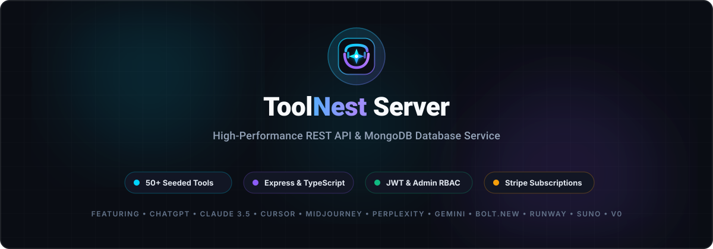

# ⚡ ToolNest Server — Express, TypeScript & MongoDB REST API

<div align="center">



### High-Performance Backend API & Database Engine for ToolNest Platform

[](https://toolnest-server.onrender.com/api)
[](https://tool-nest-client.vercel.app)
[](https://nodejs.org/)
[](https://expressjs.com/)
[](https://www.typescriptlang.org/)
[](https://www.mongodb.com/)
[](https://stripe.com/)

---

### 👨‍💻 Connect with Developer (Atahar Shihab)

[](mailto:shihabatahar@gmail.com)
[](https://github.com/Atahar-Shihab)
[](https://www.linkedin.com/in/atahar-shihab)
[](https://www.facebook.com/atahar.shihab.740192/)

</div>

---

## 📖 Architecture & Features

The **ToolNest Server** provides a robust, scalable RESTful backend service built on Node.js, Express, and TypeScript. It interfaces with MongoDB Atlas to power:

- **AI Tools Directory**: Multi-criteria search, category filtering, pagination, and sorting.
- **Role-Based Access Control (RBAC)**: Secure separation between public visitors, registered users, and system administrators via JWT and role middlewares.
- **Google OAuth 2.0 Verification**: Server-side token validation with `google-auth-library`.
- **Review & Rating Aggregation**: Atomic calculation of average star ratings upon review creation or deletion.
- **Stripe Payment Engine**: Creation of Stripe `PaymentIntent`s for one-time Pro upgrades with server-side confirmation.
- **Admin Moderation**: Tool approval/rejection workflows, review deletion, and category analytics.

---

## 📡 API Endpoints Reference

### 🏥 System Status
| Method | Endpoint | Description | Access |
| :--- | :--- | :--- | :--- |
| `GET` | `/` | Root API status and welcome response | Public |
| `GET` | `/api/health` | Uptime check and timestamp | Public |

### 🔐 Authentication (`/api/auth`)
| Method | Endpoint | Description | Access |
| :--- | :--- | :--- | :--- |
| `POST` | `/api/auth/register` | Register account with email, name, and hashed password | Public |
| `POST` | `/api/auth/login` | Authenticate credentials and return JWT bearer token | Public |
| `POST` | `/api/auth/google` | Verify Google ID token and provision session | Public |
| `GET` | `/api/auth/me` | Fetch authenticated user profile | User / Admin |

### 🛠️ AI Tools (`/api/tools`)
| Method | Endpoint | Description | Access |
| :--- | :--- | :--- | :--- |
| `GET` | `/api/tools` | Query approved tools (supports `search`, `category`, `pricing`, `sort`, `page`, `limit`) | Public |
| `GET` | `/api/tools/featured` | Fetch top curated tools for the home view | Public |
| `GET` | `/api/tools/:id` | Fetch complete tool details by ID | Public |
| `GET` | `/api/tools/my-tools` | Fetch tools submitted by the authenticated user | User |
| `POST` | `/api/tools` | Submit a new AI tool (status defaults to `pending`) | User |
| `PUT` | `/api/tools/:id` | Update tool specifications | Owner / Admin |
| `DELETE` | `/api/tools/:id` | Permanently remove a tool | Owner / Admin |
| `PATCH` | `/api/tools/:id/status` | Approve or reject a submitted tool with feedback | Admin |
| `PATCH` | `/api/tools/:id/feature` | Toggle featured spotlight badge | Admin |

### 💬 Reviews (`/api/reviews`)
| Method | Endpoint | Description | Access |
| :--- | :--- | :--- | :--- |
| `GET` | `/api/reviews/:toolId` | Fetch all reviews for a specific tool | Public |
| `GET` | `/api/reviews/my-reviews` | Fetch reviews written by the authenticated user | User |
| `POST` | `/api/reviews` | Submit star rating (1-5) and feedback comment | User |
| `DELETE` | `/api/reviews/:id` | Remove a review and recalculate tool average | Admin |

### 🔖 Bookmarks (`/api/bookmarks`)
| Method | Endpoint | Description | Access |
| :--- | :--- | :--- | :--- |
| `GET` | `/api/bookmarks` | Fetch user's saved tools | User |
| `POST` | `/api/bookmarks/toggle` | Toggle bookmark status and update tool bookmarkCount | User |
| `GET` | `/api/bookmarks/check/:toolId` | Check if a tool is bookmarked by the user | User |

### 💳 Payments (`/api/payments`)
| Method | Endpoint | Description | Access |
| :--- | :--- | :--- | :--- |
| `POST` | `/api/payments/create-intent` | Initialize Stripe PaymentIntent ($5.00 Pro upgrade) | User |
| `POST` | `/api/payments/confirm` | Confirm payment and upgrade user account to `isPro: true` | User |

### 📊 Admin Operations (`/api/users`)
| Method | Endpoint | Description | Access |
| :--- | :--- | :--- | :--- |
| `GET` | `/api/users` | List all registered platform users | Admin |
| `PATCH` | `/api/users/:id/role` | Update user role (`user` ↔ `admin`) | Admin |
| `DELETE` | `/api/users/:id` | Delete user account | Admin |
| `GET` | `/api/users/analytics` | Aggregate tool counts, category stats, and average ratings | Admin |

---

## 🗄️ Database Schemas (Mongoose)

### Tool Schema (`src/models/Tool.ts`)
```typescript
{
  title: String,             // Tool name (e.g. "ChatGPT", "Cursor")
  shortDescription: String,  // Concise summary
  fullDescription: String,   // In-depth technical overview
  category: String,          // Productivity, Coding, Design, Video, Music, Writing, Marketing, Research
  pricing: String,           // Free Plan, Free Trial, Paid
  website: String,           // Official web app URL
  thumbnail: String,         // Official CDN brand logo URL
  tags: [String],            // Categorical tags
  features: [String],        // Key feature bullet points
  aiModel: String,           // Primary model (e.g. "Claude 3.5 Sonnet", "GPT-4o")
  company: String,           // Creator organization (e.g. "Anthropic", "Anysphere")
  foundedYear: Number,       // Founding year
  history: String,           // Founding context and milestones
  avgRating: Number,         // Default: 0
  totalReviews: Number,      // Default: 0
  bookmarkCount: Number,     // Default: 0
  isFeatured: Boolean,       // Default: false
  status: String,            // 'pending' | 'approved' | 'rejected'
  submittedBy: ObjectId,     // Ref: 'User'
  rejectionFeedback: String, // Feedback if rejected
  createdAt: Date
}
```

---

## 🚀 Local Development Setup

### 1. Clone & Install
```bash
git clone https://github.com/Atahar-Shihab/ToolNest_Server.git
cd ToolNest_Server
npm install
```

### 2. Configure Environment (`.env`)
Create a `.env` file in the root directory:
```env
PORT=5000
MONGODB_URI=mongodb+srv://<username>:<password>@cluster0.mongodb.net/toolnest?retryWrites=true&w=majority
JWT_SECRET=your_jwt_secret_key_here
STRIPE_SECRET_KEY=sk_test_your_stripe_secret_key
GOOGLE_CLIENT_ID=your_google_client_id.apps.googleusercontent.com
```

### 3. Seed Database with 50 Verified AI Tools
```bash
npm run seed
```

### 4. Run Development Server
```bash
npm run dev
```
The server will run on [http://localhost:5000](http://localhost:5000).

### 5. Build for Production
```bash
npm run build
npm start
```

---

## 📬 Developer Contact

Developed with passion by **Atahar Shihab**:
- 📧 **Email**: [shihabatahar@gmail.com](mailto:shihabatahar@gmail.com)
- 🐙 **GitHub**: [github.com/Atahar-Shihab](https://github.com/Atahar-Shihab)
- 💼 **LinkedIn**: [linkedin.com/in/atahar-shihab](https://www.linkedin.com/in/atahar-shihab)
- 📘 **Facebook**: [facebook.com/atahar.shihab.740192](https://www.facebook.com/atahar.shihab.740192/)

License: [MIT](LICENSE)
